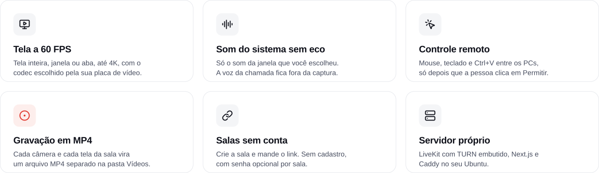
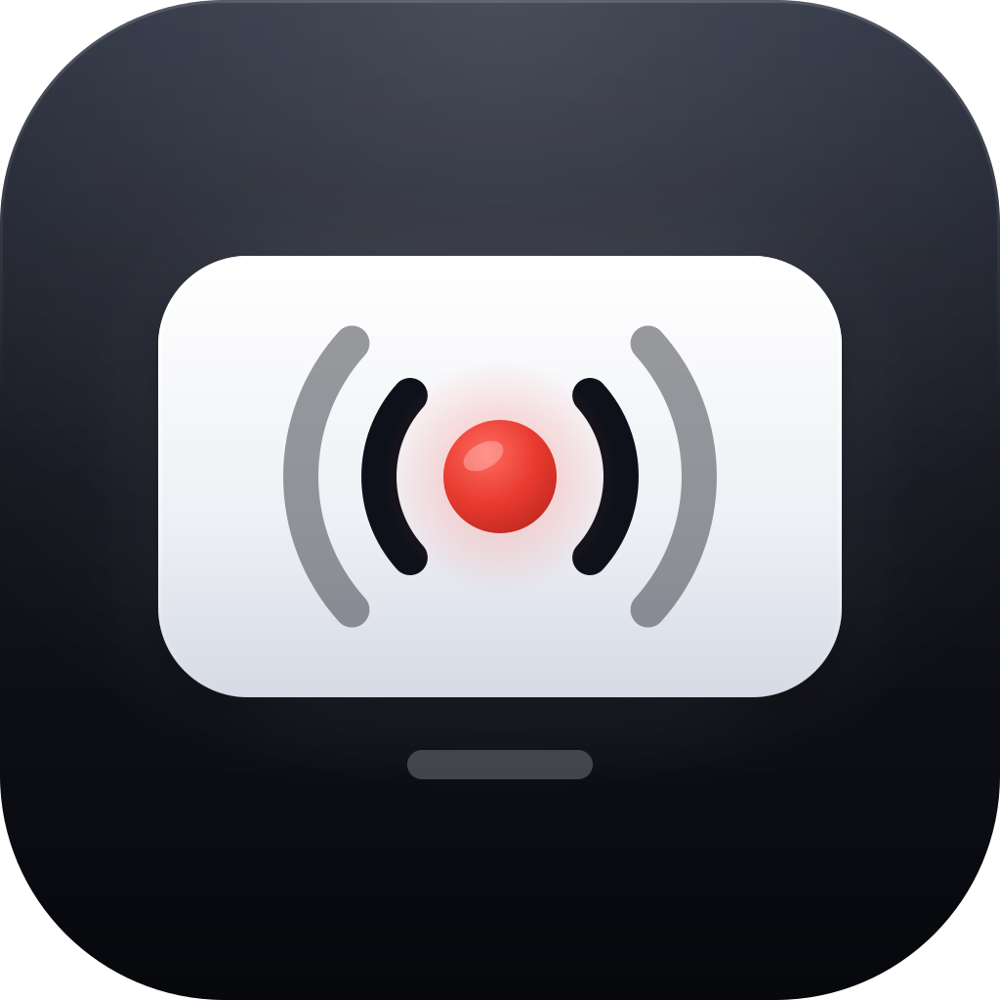

<p align="center">
  <picture>
    <source media="(prefers-color-scheme: dark)" srcset=".github/readme/banner-dark.svg">
    
  </picture>
</p>

<p align="center">
  <a href="https://github.com/riique/MyScreen/releases/latest"></a>
  &nbsp;
  <a href="https://myscreen.haumea.fun"></a>
</p>

<p align="center">
  Crie uma sala, mande o link e compartilhe a tela com o som do computador e a câmera ligada.<br>
  Funciona no navegador, e o app de Windows faz o que o navegador não consegue.
</p>

<br>

<picture>
  <source media="(prefers-color-scheme: dark)" srcset=".github/readme/features-dark.svg">
  
</picture>

## Como usar

1. Abra **[myscreen.haumea.fun](https://myscreen.haumea.fun)** e crie uma sala. Não precisa de conta.
2. Mande o link. Quem abrir entra na mesma sala, pelo navegador ou pelo app.
3. Clique em **Compartilhar** e escolha a tela, a janela ou a aba.

Para som do sistema sem eco, som de uma janela só, fone 7.1, controle remoto e gravação, use o
**[app de Windows](https://github.com/riique/MyScreen/releases/latest)**. Ele se atualiza sozinho.

## O que tem aqui

| Pasta | O que é |
| :--- | :--- |
| [`web/`](web) | O site e o servidor: Next.js, LiveKit SFU com TURN embutido, SQLite + Prisma e Caddy, com deploy por Docker Compose num Ubuntu. [Detalhes](web/README.md) |
| [`app/`](app) | O app de Windows: Electron, React e um addon em Rust para o som por processo (WASAPI) e o controle remoto. [Detalhes](app/README.md) |
| [`app/brand/`](app/brand) | A marca: ícone, cores e tipografia. Fonte única, copiada para o site por `npm run brand:sync`. |

## Desenvolvimento

```bash
# site
cd web && npm install && npm run dev

# app de Windows (Node 22+, Rust stable)
cd app && npm install && npm run build:native && npm run dev
```

A configuração do servidor, as variáveis obrigatórias e o deploy estão em
[`web/README.md`](web/README.md). Os comandos do app, a segurança e a publicação das atualizações
estão em [`app/README.md`](app/README.md).

<br>

<p align="center">
  <br>
  <sub>MyScreen — o seu próprio canal.</sub>
</p>
